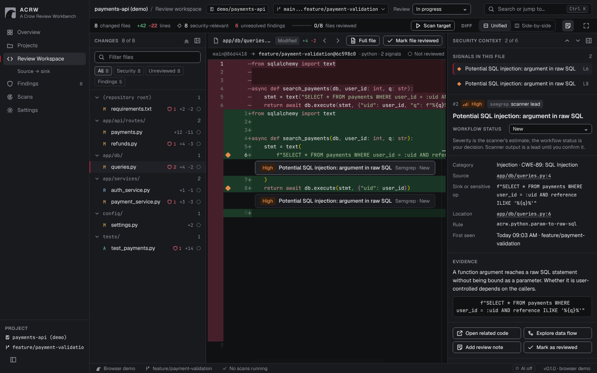
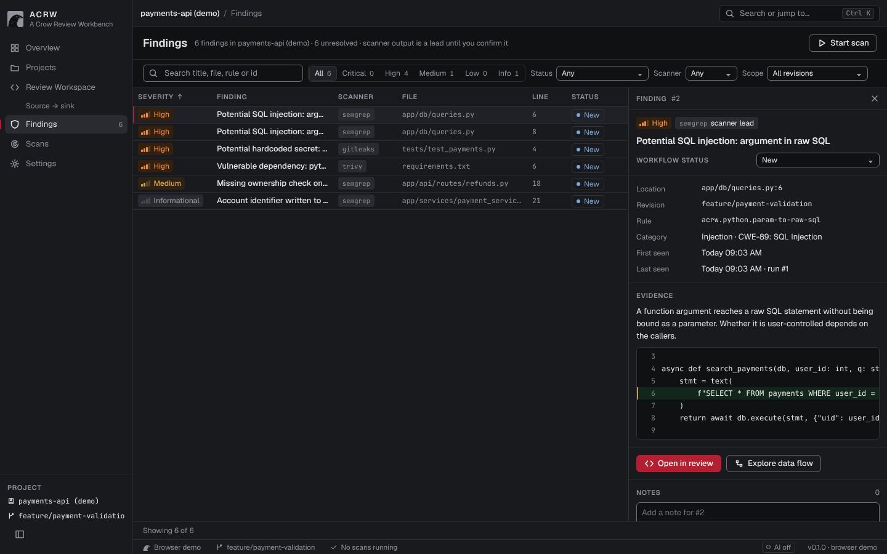
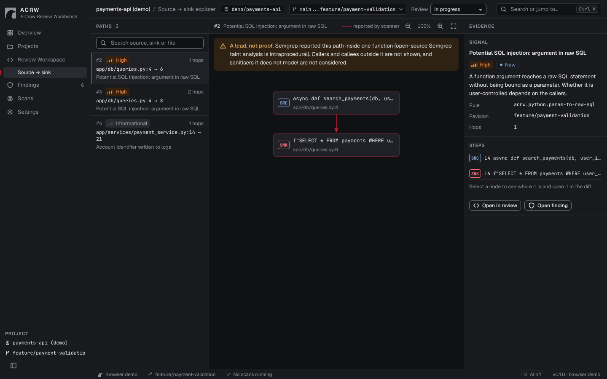

<p align="center">
  
</p>

<h1 align="center">ACRW — A Crow Review Workbench</h1>

<p align="center">
  A local-first desktop workbench for security review of Git changes.<br>
  Diff, scanner findings and source → sink paths in one quiet, dense tool.
</p>

<p align="center">
  <a href="https://github.com/sudok8s/acrw/actions/workflows/ci.yml"></a>
  <a href="LICENSE"></a>
  
  
</p>



Open a repository, pick `base...target`, read the change, run **Semgrep**,
**Trivy** and **Gitleaks** on the target revision, triage what they report and
follow source → sink paths — all on your machine. ACRW reads repositories and
never writes to them.

> **Scanner output is a lead, not a verdict.** Every result starts as *New*;
> only you move it to Confirmed, False positive, Accepted risk and so on.

## Status

ACRW is an **MVP**. It is usable for real reviews, but expect rough edges,
breaking changes to the local database and missing features. Feedback and
issues are very welcome.

## Features

| | |
| --- | --- |
| **Review workspace** | Three-dot changesets (`base...target`) via libgit2 · change explorer with search, filters and per-file *reviewed* state · Monaco diff (unified / side-by-side, collapsed / full file) · finding markers and inline notes · security-context pane with workflow status, evidence and notes · resizable, collapsible panes and focus mode |
| **Scans** | Semgrep, Trivy (`fs --scanners vuln`) and Gitleaks (working tree or commits since the merge base) run as local processes in a temporary `git worktree` · background runs with live log, cancel and retry · findings de-duplicated across runs, keeping your status and notes |
| **Findings** | Project-wide table with search, severity / status / scanner / scope filters and sorting · detail panel with code context and notes · secrets are scanned with `--redact` and masked again |
| **Source → sink** | Paths from Semgrep taint traces · bundled taint rules for Python services (`rules/acrw-python.yml`) |
| **Workflow** | Overview to resume work · command palette (`Ctrl/⌘ K`) · `J`/`K` signals, `[`/`]` files, `R` mark file reviewed |

<table>
  <tr>
    <td></td>
    <td></td>
  </tr>
</table>

## Install

Pre-built installers are attached to [GitHub releases](https://github.com/sudok8s/acrw/releases)
when available. They are not code-signed yet, so macOS Gatekeeper and Windows
SmartScreen will warn on first launch. Building from source avoids that.

### Build from source

Requirements:

- **Rust** (stable, via [rustup](https://rustup.rs)) and **Node.js 20+**
- **Git** on `PATH` (ACRW uses temporary worktrees)
- Platform toolchain — see the [Tauri prerequisites](https://v2.tauri.app/start/prerequisites/):
  - **macOS:** `xcode-select --install`
  - **Windows:** Microsoft C++ Build Tools; WebView2 ships with Windows 10/11
  - **Linux:** `libwebkit2gtk-4.1-dev libgtk-3-dev librsvg2-dev`

```bash
git clone https://github.com/sudok8s/acrw.git && cd acrw
npm run setup     # Tauri CLI and UI dependencies
npm run dev       # run the desktop app (first build compiles Rust: 5–10 min)
npm run build     # release build and installers in target/release/bundle
```

### Scanners

Install the ones you want; ACRW finds them on `PATH` or at the path set in
*Settings › Scanners*.

| Scanner | macOS | Windows / Linux |
| --- | --- | --- |
| Semgrep | `brew install semgrep` | `pip install semgrep` (Windows also via WSL) |
| Trivy | `brew install trivy` | [release binaries](https://github.com/aquasecurity/trivy/releases) |
| Gitleaks ≥ 8.19 | `brew install gitleaks` | [release binaries](https://github.com/gitleaks/gitleaks/releases) |

Trivy downloads its vulnerability database on first use; set a mirror in
Settings if the default registry is blocked on your network.

## Try it

```bash
npm run demo-repo -- ~/acrw-demo/payments-api
```

In ACRW: **Add repository…** → `~/acrw-demo/payments-api` →
`main...feature/payment-validation` → **Open review** → **Scan target**.

`npm run ui` serves the interface in a browser with a recorded demo dataset and
no backend — handy for UI work.

## How it works

```
crates/acrw-core   Rust core: git (libgit2), SQLite store, scanner runners and report parsers
src-tauri          Desktop shell (Tauri 2): commands over the core, background scan threads
ui                 React + TypeScript + Monaco, styled with the ACRW design tokens
rules              Bundled Semgrep rules (embedded into the binary)
scripts            Demo repository generator
```

Data lives in the OS app-data folder: `acrw.db` (projects, reviews, findings,
notes, settings) and `work/` (scanner reports). Removing a project deletes only
ACRW's records.

## Privacy

- Repositories are read, never written. Scans run in a temporary worktree that is removed afterwards.
- Scanners run with telemetry and update checks off (`--metrics=off`, `SEMGREP_ENABLE_VERSION_CHECK=0`).
- Network access happens only when a scanner needs it: Trivy's vulnerability DB, and Semgrep registry packs (`p/...`) if you add them.
- There is no AI integration in the MVP; nothing is sent anywhere.

## Limitations

- Source → sink paths come from open-source Semgrep taint analysis, which is **intraprocedural**: a path never crosses function or file boundaries.
- Semgrep ≥ 1.1xx only prints traces in its text report; ACRW parses that report, so a format change upstream can drop traces.
- Large repositories are untested; the change explorer and findings table are not virtualised yet.
- AI assistance and scan-report retention are settings only.

## Roadmap

- Merge/pull request review (GitLab, GitHub) on top of local changesets
- Cross-file data-flow for Python and C#, starting with call-graph stitching of Semgrep traces
- C# rule pack; more Python frameworks (Django, Flask)
- SARIF import from other tools; export to DefectDojo
- Optional, local-first AI explanations with explicit, redacted context
- Signed installers

## Contributing

Issues, rules and pull requests are welcome — see [CONTRIBUTING.md](CONTRIBUTING.md)
and the [code of conduct](CODE_OF_CONDUCT.md). To report a vulnerability in
ACRW itself, follow [SECURITY.md](SECURITY.md) instead of opening an issue.

## License

[Apache License 2.0](LICENSE). Semgrep, Trivy and Gitleaks are separate
programs under their own licenses and are not distributed with ACRW.
